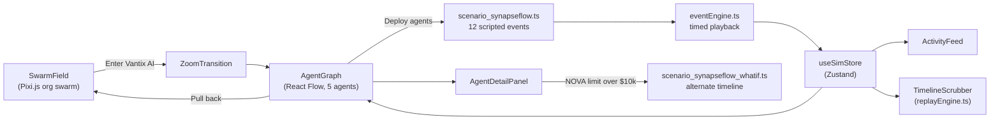

> **Hackathon demo, archived.** This repository is a finished presentation prototype
> and is no longer maintained.

# Veridian: Agent Operations Center

Veridian is a hackathon demo of an operations center for a company that runs hundreds of
AI agents alongside its human staff. Its pitch is that each agent should carry a trust
score that determines how much money it may spend, and that this score should change
with the agent's behavior. The fictional customer is "Vantix AI", a company with 500
human employees and about 600 AI agents.

**The scenario is scripted.** No real agents, models or payments are involved. The
story plays back a fixed sequence of events, and only the ambient background traffic is
randomized. The core demo runs fully offline.

## What the demo shows

1. **Org swarm.** The demo opens on a Pixi.js particle field representing the company's
   agents, with org-wide metrics in the status bar.
2. **Zoom into a cluster.** *Enter Vantix AI* animates into a React Flow graph of five
   named agents: AURORA (executive), VEGA (negotiation), SENTINEL (governance), ATLAS
   (procurement) and NOVA (cost optimization). Each has a trust score, a spending limit,
   a model and a builder.
3. **The SynapseFlow story.** A vendor opportunity appears ("40% lower cost, $240,000
   potential annual savings"). Deploying the agents plays a 12-event script: ATLAS
   finds the vendor, the agents review the terms, correlated agent activity is detected,
   NOVA tries to proceed without vendor verification, SENTINEL blocks it, and trust
   scores and spending limits are re-weighted. The live activity feed narrates each step.
4. **What-if.** Raising NOVA's spending limit to $10,000 or more arms an alternate
   12-event timeline in which NOVA commits $18,400 before SENTINEL can intervene.
5. **Inspect and replay.** An agent detail panel shows trust dimensions and history. A
   timeline scrubber replays the scenario deterministically to any event. *Pull back*
   returns to the swarm.



## Run it

Requires Node 20.19+ or 22.12+ (needed by Vite 8).

```bash
npm install
npm run dev        # open the URL Vite prints (default http://localhost:5173)
```

Click path: **Enter Vantix AI** → **Deploy agents to investigate** → watch SENTINEL
block NOVA → open NOVA and raise its limit past $10,000 → **Re-run alternate timeline** →
**Pull back**. Presenter hotkeys (Enter, O, D, W, B, Shift+R) are listed in
[DEMO_PRESENTER.md](DEMO_PRESENTER.md).

Other scripts: `npm run build` (type-check and bundle) and `npm run lint` (oxlint).

The optional **+ Agent** modal can generate a one-line agent blurb with OpenAI when
`OPENAI_API_KEY` is set in the dev server's environment (`npm run dev` only). The call
goes through a Vite dev-server proxy (`vite.config.ts`), so the key never reaches the
browser. Without a key it uses a local fallback.

## Stack

React 19, TypeScript, Vite 8, Tailwind CSS 4, Pixi.js 8 (swarm), React Flow 11 (agent
graph), Zustand (state), Framer Motion, oxlint.

## Repository guide

| File | Contents |
|------|----------|
| [PROJECT_STATE.md](PROJECT_STATE.md) | Architecture, component map, where to change what |
| [DEMO_PRESENTER.md](DEMO_PRESENTER.md) | Hotkeys and click path for presenting |
| [demo_script.md](demo_script.md) | The spoken 7-minute pitch |
| [idea_overview.md](idea_overview.md) | The product thesis behind the demo |
| [mvp_demo_spec.md](mvp_demo_spec.md) | The original implementation spec |
| `src/engine/scenario_synapseflow.ts` | The scripted story |

The pitch was written with Ramp as the company that could build this product, so Ramp
appears in the script and strategy documents. The product itself is named Veridian.

## License

[MIT](LICENSE)
